<div align="center">



[](https://www.linkedin.com/in/faizan-kaishar-5b53a7235)
[](https://faizankaishar.netlify.app)
[](mailto:faizankaishar95@gmail.com)
[](https://github.com/faiz1487)




</div>

## 👨‍💻 About Me

I'm **Faizan Kaishar**, a Cloud & DevOps Engineer based in **Noida, Uttar Pradesh, India**. I work with AWS infrastructure, Infrastructure as Code, container orchestration, CI/CD automation, and observability. My background in manufacturing automation informs how I approach reliable operations and system design.

- ☁️ **Cloud:** AWS (EC2, S3, RDS, VPC, IAM, CloudWatch, EKS); Azure
- 🧱 **Infrastructure as Code:** Terraform, Ansible; familiar with CloudFormation
- 🚀 **Delivery:** Docker, Kubernetes, Helm, Jenkins, GitHub Actions
- 📊 **Observability:** Prometheus, Grafana, Amazon CloudWatch
- 🐍 **Scripting:** Python, Bash, Linux
- 🎯 **Focus:** Repeatable infrastructure, secure delivery, scalable services

<div align="center"></div>

## 🛠️ Tools & Technologies

<div align="center">




</div>

## 📂 Featured DevOps Projects

> These are project descriptions from my portfolio. Repository links below are relative placeholders until the project folders are published in this profile repository.

| Project | Overview | Stack |
|:--|:--|:--|
| 🏭 **[MES Data Pipeline](./mes-project)** | Simulated manufacturing telemetry pipeline: raw events in S3, structured records in RDS, automated provisioning and deployment, CloudWatch alarms. | AWS, Terraform, Ansible, Docker, GitHub Actions |
| ☸️ **[Microservices on AWS](./microservices-aws)** | Containerized Java microservices on EKS with Helm deployments, Jenkins CI/CD and horizontal pod autoscaling. | Java, Docker, EKS, Helm, Terraform, Jenkins |
| 🔐 **[Hybrid Secure CI/CD](./hybrid-ci-cd)** | Pipeline concept combining image scanning, image signing, ECR publishing, EKS deployment and rollback checks. | GitHub Actions, Jenkins, Trivy, Docker, ECR, EKS |

## 🔄 DevOps Delivery Lifecycle

```text
💻 Code → 🧪 Test → 🏗️ Build → 🔐 Scan → 📦 Publish → ☸️ Deploy → 📊 Monitor
   Git        CI        Docker      Trivy        ECR          EKS       Grafana
```

## 📈 GitHub Dashboard

<div align="center">


</div>

## 🌃 My 3D Contribution City

<div align="center">

*Every contribution helps build the city. Updated daily by GitHub Actions after initial setup.*


</div>

> **Setup:** Enable GitHub Actions write permissions and run the included `3D Contribution Graph` workflow once. The graph will not appear until the `output` branch is generated.

## 🗺️ Learning & Development Roadmap

- [ ] Modular Terraform EKS infrastructure with production-minded security defaults
- [ ] Protected GitHub Actions environments and secrets-management examples
- [ ] Architecture diagrams and repeatable deployment demos
- [ ] GitOps deployment examples and enhanced observability

## ▶️ Example: Run the MES Demo

```bash
# Replace this with the URL of the actual project repository if separate.
git clone https://github.com/faiz1487/faizan-devops-portfolio.git
cd faizan-devops-portfolio/mes-project/terraform
terraform init
terraform plan -var-file=envs/dev.tfvars
# Review the plan and expected AWS charges before applying.
terraform apply -var-file=envs/dev.tfvars
```

> Commands are illustrative and require the corresponding project files, AWS credentials, and a valid environment configuration. Destroy unused cloud resources to avoid charges.

## 📬 Let's Connect

<div align="center">


[](https://www.linkedin.com/in/faizan-kaishar-5b53a7235)
[](https://faizankaishar.netlify.app)
[](mailto:faizankaishar95@gmail.com)

**Automate thoughtfully. Deploy confidently. Monitor continuously.** ⚡

</div>
